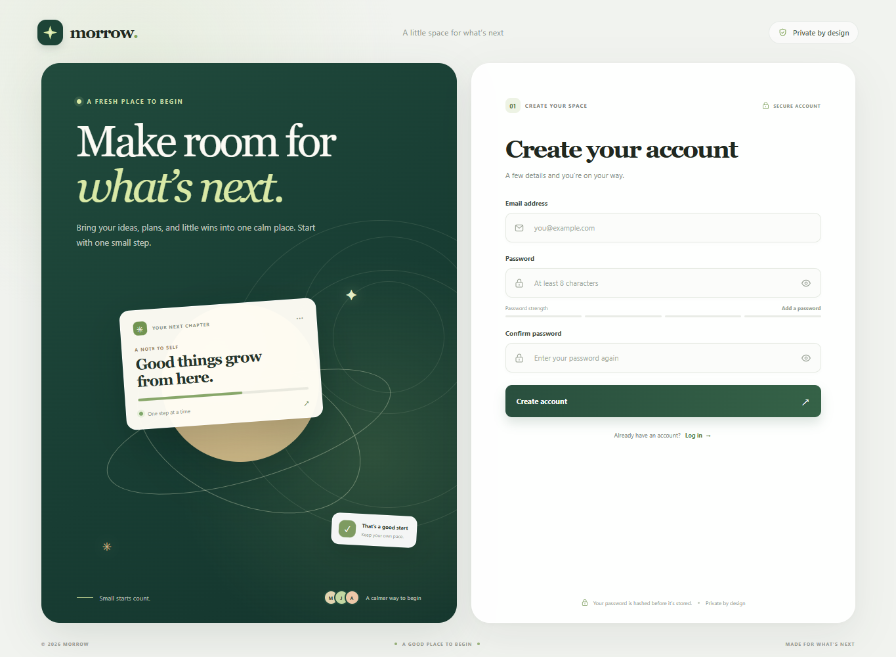

# React, Express, REST API, and MongoDB signup

A polished, responsive signup and login experience connected to an Express REST API. MongoDB stores each account, and bcrypt stores a password hash instead of the original password.

## Preview




*The demo uses sample form values and does not submit them.*

## How the signup process works

1. **The React form collects credentials.** It checks that the email is valid and that a new password has at least 8 characters. The browser sends JSON to the API and shows a useful success or error message.
2. **Express receives `POST /api/auth/signup`.** The route trims and lowercases the email, checks the email and password limits, and returns a clear validation response when input is invalid.
3. **MongoDB prevents duplicate accounts.** The `User` model has a unique email index. The API also handles MongoDB's duplicate-key response in case two signup requests arrive at once.
4. **The password is hashed.** `bcryptjs` hashes the password before it is saved. The API never returns the hash.
5. **The API returns success.** A new account gets HTTP `201`. The form switches to the login view and lets the person sign in.
6. **Login checks the saved hash.** `POST /api/auth/login` finds the normalized email and compares the submitted password with its hash. A mismatch returns HTTP `401`.

## Run it locally

### 1. Install prerequisites

- Node.js LTS and npm
- MongoDB running locally, or a MongoDB Atlas connection string

### 2. Configure MongoDB

Create a `.env` file in the project folder and set your MongoDB address. For a local database named `signup_app`, use:

```env
MONGODB_URI=mongodb://127.0.0.1:27017/signup_app
PORT=3000
```

Keep `.env` on your computer. Git ignores it, so the file and any database credentials are not uploaded.

### 3. Install project dependencies

From this project folder, run:

```powershell
npm install
```

### 4. Start MongoDB

Start your local MongoDB service. If using Atlas, make sure the database user and network access are configured for your connection string.

### 5. Start the app

```powershell
npm run dev
```

This starts the Vite development server and the Express server. Open [http://localhost:5173](http://localhost:5173). Vite forwards `/api` requests to Express on port `3000`.

### 6. Create an account

Enter an email address and a password with at least 8 characters, then choose **Sign Up**. A successful signup switches the form to **Log In**. The same email cannot be registered twice.

## API reference

### `POST /api/auth/signup`

Request:

```json
{
  "email": "student@example.com",
  "password": "strongpassword123"
}
```

Success (`201`):

```json
{
  "message": "Account created successfully. You can now log in.",
  "user": {
    "id": "MongoDB user id",
    "email": "student@example.com"
  }
}
```

Invalid input returns `400`; an email already in use returns `409`.

### `POST /api/auth/login`

Accepts the same JSON fields. Valid credentials return the user ID and email. Invalid credentials return `401` without revealing whether the email exists.

### `GET /api/health`

Returns the API status and whether its MongoDB connection is active.

## Project map

- `src/main.jsx` — React signup and login forms and API requests
- `src/style.css` — signup page styling
- `routes/auth.js` — signup and login REST endpoints
- `models/User.js` — MongoDB user schema and unique email index
- `server.js` — Express app, MongoDB connection, API routes, and production file serving
- `vite.config.js` — local `/api` proxy to Express
- `screenshots/signup-preview.png` — signup page screenshot
- `screenshots/signup-demo.gif` — animated signup and login preview

## Production build

```powershell
npm run build
npm start
```

The Express server serves the production frontend from `dist`. Set `MONGODB_URI` and `PORT` in the deployment environment.

## Security scope

Passwords are hashed with bcrypt and are never stored or returned in plain text. The API enforces a minimum of 8 characters for new passwords and bcrypt's 72-byte maximum. Login in this starter demonstrates credential checking; add a session or signed token before using it to protect private application pages.
