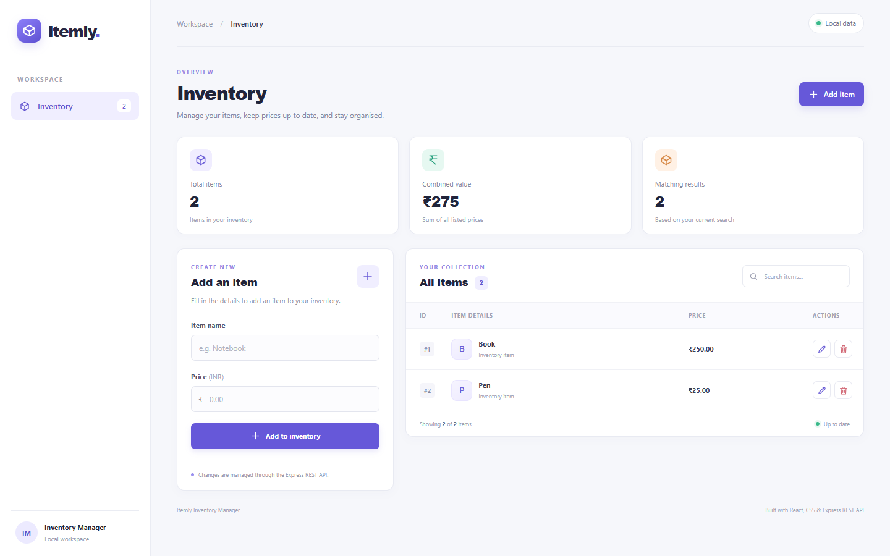
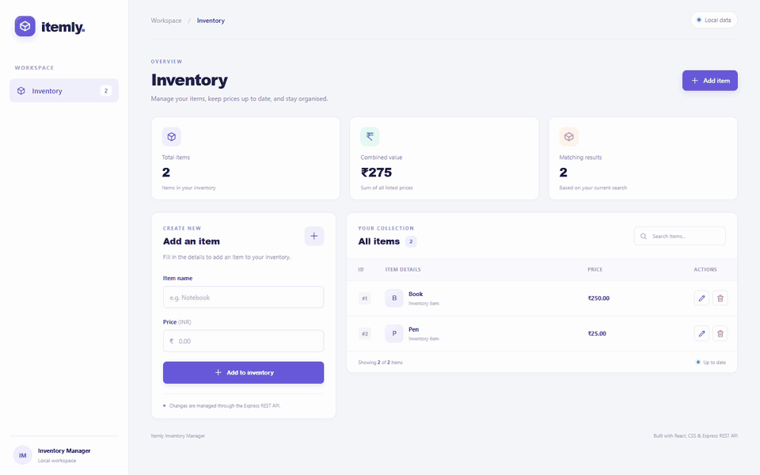

# Itemly — React CRUD Inventory Manager

Itemly is a responsive inventory dashboard built with React, CSS, Express, and a REST API. It supports creating, viewing, editing, searching, and deleting items. The starter data lives in an in-memory array, so a database is not required.

## Preview





*The animation uses sample inventory entries. Data resets when the server stops.*

## Run locally

### 1. Install Node.js

Install a current Node.js LTS release with npm.

### 2. Install dependencies

Open a terminal in this project folder and run:

```powershell
npm install
```

### 3. Start the app

```powershell
npm run dev
```

Open [http://localhost:5173](http://localhost:5173). The React development server forwards `/api` requests to Express on port `3000`.

## Use the inventory

1. Enter an item name and a non-negative price, then select **Add to inventory**.
2. Use the search field to filter items by name or ID.
3. Select the edit icon to load an item into the form, change its details, and save.
4. Select the delete icon and confirm to remove an item.

The summary cards show the number of items, their combined value, and the current number of search results. Names can contain up to 80 characters.

## REST API

| Method | Endpoint | Purpose |
| --- | --- | --- |
| `GET` | `/api/items` | List all items |
| `POST` | `/api/items` | Create an item |
| `PUT` | `/api/items/:id` | Update an item |
| `DELETE` | `/api/items/:id` | Delete an item |

Create and update requests use JSON such as:

```json
{
  "name": "Notebook",
  "price": 75.5
}
```

The API validates names and prices and returns `400` for invalid input or `404` when an item ID does not exist.

## Production build

```powershell
npm run build
npm start
```

Open [http://localhost:3000](http://localhost:3000). Express serves the built React app and the REST API.

## Project files

- `src/main.jsx` — React dashboard and CRUD interactions
- `src/style.css` — responsive Itemly styling
- `server.js` — Express REST API and production hosting
- `vite.config.js` — development proxy for `/api`
- `screenshots/itemly-preview.png` — dashboard screenshot
- `screenshots/itemly-crud-demo.gif` — animated CRUD walkthrough

## Data and environment

The starter inventory contains **Book** (₹250) and **Pen** (₹25). Changes are kept in server memory and reset when Express restarts. No database credentials or environment file are needed for this lab project.
